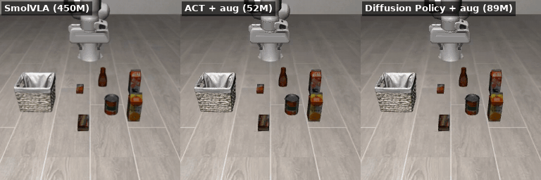
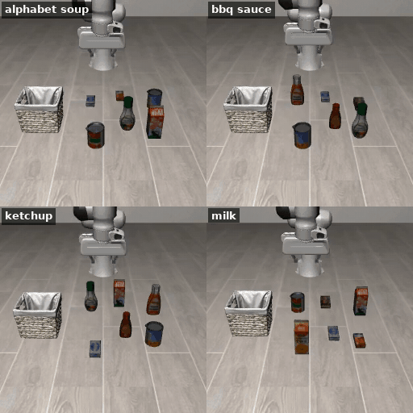
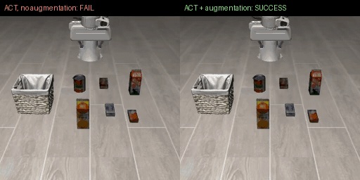

# LIBERO Imitation Study

How much do demonstrations matter, and how do a vision-language-action model (SmolVLA) and two
classic imitation-learning policies (ACT, Diffusion Policy) compare when trained on the same LIBERO data?
Everything runs on a single 6 GB laptop GPU (RTX 3060 Laptop) plus free cloud GPUs for the VLA fine-tune.

Status: work in progress (the demo-count study is running). Every number below was measured.



*The same held-out episode (tomato sauce, init state 10, seed 3000) run by all three policies.
All three finish in 116 to 126 steps.*

## Headline result (LIBERO-Object, 300 held-out episodes)

| Policy | Params | Trained by | Seed 3000 | Seed 3001 | Seed 3002 | **Total** |
| --- | --- | --- | --- | --- | --- | --- |
| SmolVLA (`lerobot/smolvla_libero`), replan every 10 | 450M | published checkpoint | 97 | 93 | 93 | 283/300 (94.3 %) |
| ACT, one model for all 10 tasks, no augmentation | 52M | this repo, 454 demos | 78 | | | 78/100 |
| **ACT, same + image augmentation** | 52M | this repo, 454 demos | 97 | 99 | 99 | **295/300 (98.3 %)** |
| Diffusion Policy, same data + augmentation | 89M | this repo, 454 demos | 85 | 96 | 98 | 279/300 (93.0 %) |

Held-out = 10 tasks x official init states 10-19, each run once per seed with every random
generator re-seeded before the episode, so each (task, init state, seed) is the same episode for
every policy. Never used for any decision: checkpoints and settings were chosen on a separate dev set
(init states 0-9, seed 2000).

Paired McNemar tests on the 300 shared episodes:

| Comparison | First better | Second better | p |
| --- | --- | --- | --- |
| ACT + aug vs Diffusion Policy | 20 | 4 | 0.0015 |
| ACT + aug vs SmolVLA | 17 | 5 | 0.017 |
| Diffusion Policy vs SmolVLA | 15 | 19 | 0.61 |
| ACT + aug vs ACT without augmentation (seed 3000 only) | 21 | 2 | 0.0001 |

So the 52M ACT model trained here is the most reliable of the three. ACT vs SmolVLA is significant on
its own but borderline once corrected for three comparisons (Bonferroni threshold 0.0167); Diffusion
Policy and SmolVLA cannot be told apart.

**Why three seeds.** Diffusion Policy and SmolVLA sample noise at inference; ACT does not (it uses
the zero latent). With one seed, a single unlucky noise draw is repeated across episodes: Diffusion
Policy scored 85/100 at seed 3000 (bbq sauce 2/10) and 96 and 98 at the other two seeds. A first
Diffusion Policy run that seeded only once at the start reported 97/100; that run was off protocol
and is superseded by this table ([log](results/log.md)).

Where they fail: almost always tall bottles (bbq sauce, salad dressing, ketchup), as an empty grasp,
a bottle that slips out after lifting, or a bottle knocked over. None of the policies retries after a
missed grasp; the demonstrations never show one.

## Rollouts

| One Diffusion Policy model, four different tasks (held-out) | What image augmentation fixed (ACT, same dev episode) |
| --- | --- |
|  |  |

Left: alphabet soup, bbq sauce, ketchup and milk, each placed in the basket by the same policy; the
scene, not a language prompt, tells it which object to pick. Right: without augmentation ACT hovers
beside the milk carton until timeout; with augmentation it grasps and places it. More clips, including
failures, are in [results/videos](results/videos).

## Before trusting any number: reproducing a published result

The first step was not training anything but checking the evaluation itself, by evaluating the public
checkpoint `lerobot/smolvla_libero` (trained on the same dataset) and comparing with the published score.

| Check | Result |
| --- | --- |
| Published SmolVLA (0.45B), LIBERO-Object | 96.0 % |
| `lerobot-eval`, 10 tasks x 5 episodes, seed 1000 | **56 %** (28/50) |
| Same run, 1st episode of each task only | 90 % (9/10) |
| Same run, episodes 3 to 5 | 40 % (12/30) |

What explains the gap, tested one variable at a time with `tools/eval_libero.py` (which reproduces
`lerobot-eval` episode for episode):

1. **Not environment reuse.** A fresh simulator per episode gives identical outcomes.
2. **Not the sampling seed.** Re-seeding before every episode, 3 seeds x 20 init states: 59 of 60
   outcomes are the same for all three seeds. The first episode only looked better because the
   official init state 0 happens to be easy (12/12) while init state 3 is never solved (0/12).
3. **The MuJoCo version.** The training frames were rendered with an older MuJoCo. Bisecting
   versions with `tools/render_probe.py`: 3.3.2 and earlier reproduce the dataset's floor colour,
   3.3.3 and later (LeRobot installs 3.8.1) render it about 28 % darker. Pinning `mujoco==3.3.2`
   changes nothing else.

| Same checkpoint, same protocol (10 tasks x 5 episodes, seed 1000) | Success |
| --- | --- |
| MuJoCo 3.8.1 (default install) | 56 % (28/50) |
| MuJoCo 3.3.2 (matches training renders) | **72 % (36/50)** |

On the 20-state grid, every episode solved under 3.8.1 is also solved under 3.3.2 (9/20 to 16/20).
A 24 point gap to the published 96 % remains.

## Fixing the remaining gap: open-loop action chunks

Rollout videos of the failures show the arm reaching the target but missing the grasp, then
carrying on with the place motion. The checkpoint executes all 50 actions of a predicted chunk
(2.5 s) before looking again. Replanning every 10 actions (`n_action_steps=10`, inference only,
same weights):

| SmolVLA reference, MuJoCo 3.3.2 | Open-loop 50 | Replan every 10 |
| --- | --- | --- |
| 10 tasks x init states 0-9, seed 2000 | 78/100 | **94/100** (20 fixed, 4 broken, McNemar p = 0.0015) |
| Held-out: init states 10-19, seed 3000 | | **97/100** (published: 96 %) |

The replanning interval was chosen on the first sample and then confirmed on the held-out one.

## ACT, single task (alphabet soup, 44 demos)

| Setting (all 50 official init states, seed 4000) | Success |
| --- | --- |
| 10k steps, simulator renders 360 px | 0/50 |
| 10k steps, 256 px (as in training) | 5/50 |
| 10k steps, 256 px, replan every 10 | 38/50 |
| 40k steps (final), 256 px, replan every 10 | **50/50** |

* ACT has no internal resize, so a 360 px render gives a different feature map than the 256 px
  training frames. Open-loop predictions on dataset frames were close to the recorded actions,
  which pointed at the input rather than training (`tools/diagnose_policy.py`).
* Replanning matters even more for ACT than for SmolVLA (fixed 34, broken 1).
* Intermediate checkpoints (20k: 39/50, 30k: 38/50) are no better than 10k; only the final one is.
* Limitation: one task, and all 50 official init states were used, so no held-out states remain.

## ACT, one model for all 10 tasks (454 demos)

ACT gets no language input; every LIBERO-Object task has a different object set, so the scene
identifies the task (checked in the bddl files, and confirmed in videos: it always goes for the
correct object). Dev set, replan every 10:

| Change (one at a time) | Dev success |
| --- | --- |
| 50k / 75k / 100k steps | 76 / 85 / 89 |
| replan every 5 instead of 10 (50k) | 71 (no gain) |
| ACT temporal ensembling 0.01 (50k) | 45 (worse: blurs late grasp corrections) |
| 150k / 200k steps | 82 / 83 (plateau; loss still falls) |
| mean of 100k..200k weights | 83 (no gain) |
| **image augmentation** (LeRobot defaults: colour jitter, +-5 deg, 5 % shift), 50k / 75k / 100k | **96 / 95 / 93** |

Failures without augmentation were imprecise grasps on tall objects (milk carton, ketchup bottle):
gripper beside the carton, bottle released next to the basket or knocked over. Lower training loss
without better success pointed to overfitting exact pixel positions, which augmentation addresses.
Side-by-side videos: `results/videos/`.

## Setup findings worth knowing

* **Camera orientation.** LIBERO renders images rotated 180 degrees relative to the dataset. LeRobot's
  `LiberoProcessorStep` flips them back at evaluation time; verified by comparing the policy's input
  frame with a dataset frame of the same task and init state (robot state agrees to about 5 mm).
* **Rendering differs from the data.** With MuJoCo 3.8.1 the floor renders about 28 % darker than in the
  dataset frames (RGB 136/123/111 vs 188/180/170) while objects match. The texture file is identical,
  so the difference comes from the renderer, not the assets. MuJoCo 3.3.2 gives 190/181/173, so
  `scripts/setup.sh` pins it (`tools/render_probe.py` reproduces the measurement).
* **Language matters for the comparison.** All ten LIBERO-Goal tasks start from the same scene, so
  policies without language input (ACT, Diffusion Policy) cannot tell them apart. The comparison is
  therefore done per task on LIBERO-Object, whose scenes differ per task.

## Reproduce

```bash
scripts/setup.sh           # Python 3.12 venv, lerobot[libero,smolvla]==0.6.1, torch cu128
source env.sh
python -I scripts/suite_episodes.py      # episode -> suite/task map (results/suite_episodes.json)
```

Dataset: `lerobot/libero` pinned at revision `a1aaacb7f6cd6ee5fb43120f673cebb0cfea7dd4`.

## Hardware notes

NVIDIA driver 535 supports CUDA 12.x only; the default PyPI torch wheel targets CUDA 13, so
`scripts/setup.sh` installs the cu128 build of the same torch version.
